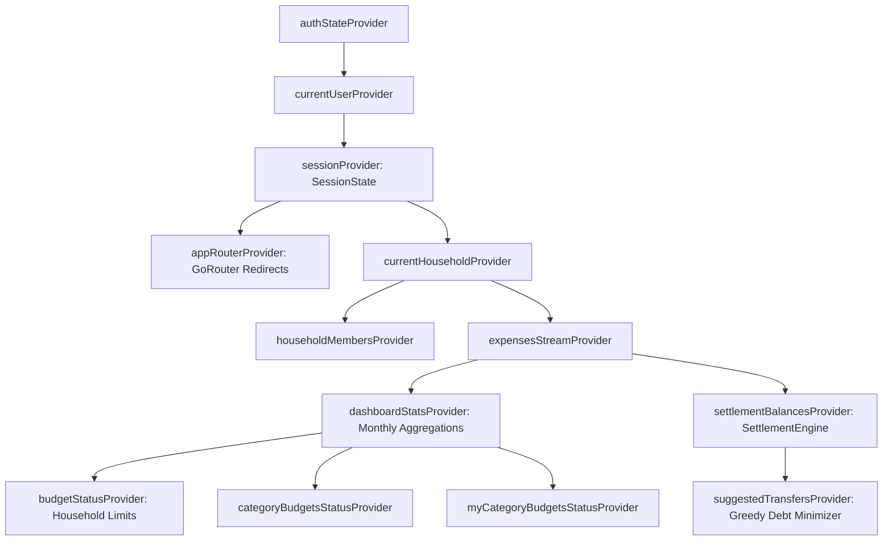

# FlatSplit — Technical Architecture Document

**System Version**: 1.2.0  
**Stack**: Flutter (Dart 3.x), Riverpod 2.x, Firebase (Auth & Cloud Firestore), GoRouter  
**Target Environments**: Android (API 21+), iOS (iOS 13+)  

---

## 1. Architectural Philosophy & Overview
FlatSplit is engineered around **Feature-First Clean Architecture** principles, enforcing strict separation of concerns, single-direction data flow, and isolated testability.

```
┌────────────────────────────────────────────────────────┐
│                   Presentation Layer                   │
│   (Widgets, Screens, AsyncNotifiers, Riverpod State)    │
└───────────────────────────┬────────────────────────────┘
                            │ depends on
┌───────────────────────────▼────────────────────────────┐
│                      Domain Layer                       │
│    (Entities, Business Logic Engines, Repositories)    │
└───────────────────────────▲────────────────────────────┘
                            │ implemented by
┌───────────────────────────┴────────────────────────────┐
│                       Data Layer                       │
│   (Firebase Repositories, DTO Mappers, Firestore API)   │
└────────────────────────────────────────────────────────┘
```

### Key Pillars:
1. **Unidirectional Reactive Flow**: UI triggers actions on Riverpod Notifiers -> Notifiers invoke Domain Repositories -> Data Layer updates Firestore -> Firestore Streams emit real-time snapshots back into Riverpod providers -> UI reacts smoothly.
2. **Integer-Safe Monetary Engine**: Floating-point rounding errors (`0.1 + 0.2 = 0.30000000000000004`) are strictly prohibited in financial code. All amounts are stored and computed in 64-bit integer paisas (`1 PKR = 100 Paisa`).
3. **Strict Domain Purity**: Domain entities and mathematical engines (e.g. `SettlementEngine`, `SplitCalculator`, `InviteCode`) have zero dependencies on Flutter or Firebase, enabling blazing fast unit test execution ($< 2$ seconds for the entire test suite).

---

## 2. Directory & Package Structure
The codebase follows a modular feature-first layout under `lib/`:

```
lib/
├── app/                        # Application composition root
│   ├── app.dart                # MaterialApp.router configuration & theme bindings
│   ├── router/                 # Navigation contracts & route definitions
│   │   ├── app_router.dart     # GoRouter instance & dynamic auth/household redirect logic
│   │   ├── routes.dart         # Path constants
│   │   └── not_found_screen.dart
│   └── theme/                  # Theme definitions (Light & Dark AppTheme)
│
├── core/                       # Shared platform primitives & utilities
│   ├── constants/              # AppConstants, FirestoreCollections
│   ├── errors/                 # AppException hierarchy & FirebaseErrorMapper
│   └── utils/                  # Money (Paisa formatting), Validators, DateFormatters
│
├── features/                   # Encapsulated vertical feature slices
│   ├── auth/                   # Authentication & profile management
│   │   ├── domain/             # AuthUser, AuthRepository, SessionState
│   │   ├── data/               # FirebaseAuthRepository
│   │   └── presentation/       # Login, SignUp, Splash, SessionProvider
│   ├── household/              # Flat setup, members, invite codes & settings
│   │   ├── domain/             # Household, HouseholdMember, InviteCode
│   │   ├── data/               # FirebaseHouseholdRepository
│   │   └── presentation/       # CreateFlat, JoinFlat, HouseholdProviders
│   ├── expenses/               # Expense logging, custom categories, splitting
│   │   ├── domain/             # Expense, SplitCalculator, CustomCategory
│   │   ├── data/               # FirebaseExpenseRepository
│   │   └── presentation/       # AddExpenseScreen, ExpensesScreen, ExpenseProviders
│   ├── dashboard/              # Aggregations, financial cards, budget targets
│   │   ├── domain/             # DashboardStats
│   │   └── presentation/       # CategoryBudgetScreen, BudgetProgressCard, DashboardProviders
│   ├── settlement/             # Debt minimization engine & settlement records
│   │   ├── domain/             # SettlementEngine, Balance, Transfer
│   │   ├── data/               # FirebaseSettlementRepository
│   │   └── presentation/       # SettleUpScreen, SettlementProviders
│   └── shell/                  # App shell & primary navigation
│       └── presentation/       # AppShellScreen, HomeScreen, MoreScreen
│
└── shared/                     # Reusable cross-feature widgets and models
    ├── models/                 # AppUser, Household, HouseholdMember
    └── widgets/                # LoadingButton, AppSnackbar, ConfirmDialog
```

---

## 3. State Management Topology (Riverpod 2.x)



### 3.1 Session State Machine (`SessionController`)
- **`SessionInitializing`**: App is booting, displaying the splash screen.
- **`SessionSignedOut`**: No Firebase user authenticated. Router locks navigation to `/welcome`, `/login`, `/signup`, or `/onboarding`.
- **`SessionNeedsHousehold`**: User signed in, but `user.householdId == null`. Router directs user to `/household/setup`.
- **`SessionReady`**: User signed in with an active flat. Full access to Home, Expenses, Settle, Budgets, and More.

---

## 4. Firestore Data Model & Schema

```
/users/{userId}
  ├── name: String
  ├── email: String
  ├── householdId: String?
  ├── photoUrl: String?
  └── createdAt: Timestamp

/inviteCodes/{code} (e.g. "FLAT-7K29")
  ├── householdId: String
  └── createdAt: Timestamp

/households/{householdId}
  ├── name: String
  ├── ownerId: String
  ├── inviteCode: String
  ├── memberCount: int
  ├── monthlyBudgetPaisa: int
  ├── categoryBudgetsPaisa: Map<String, int>
  ├── memberCategoryBudgetsPaisa: Map<String, Map<String, int>>
  ├── customCategories: List<Map> [id, label, iconCodePoint, colorValue, subcategories]
  ├── categorySubcategories: Map<String, List<String>>
  ├── currency: String ("PKR")
  ├── createdAt: Timestamp
  │
  ├── /members/{userId}
  │     ├── name: String
  │     ├── email: String
  │     ├── role: String ("owner" | "member")
  │     ├── photoUrl: String?
  │     └── joinedAt: Timestamp
  │
  ├── /expenses/{expenseId}
  │     ├── title: String
  │     ├── amountPaisa: int
  │     ├── category: String (enum name or custom id)
  │     ├── customCategoryId: String?
  │     ├── subcategory: String?
  │     ├── paidByUserId: String
  │     ├── participantUserIds: List<String>
  │     ├── splitMode: String ("equal" | "custom" | "percentage")
  │     ├── customSplitPaisa: Map<String, int>?
  │     ├── date: Timestamp
  │     ├── createdByUserId: String
  │     └── createdAt: Timestamp
  │
  └── /settlements/{settlementId}
        ├── fromUserId: String
        ├── toUserId: String
        ├── amountPaisa: int
        ├── settledAt: Timestamp
        └── recordedByUserId: String
```

---

## 5. Domain Engines & Algorithms

### 5.1 Settlement Engine (`SettlementEngine.expenses`)
Computes the minimal transfer network between $N$ roommates:
1. **Net Balance Calculation**:
   $$\text{Balance}(u) = \sum \text{PaidBy}(u) - \sum \text{OwedBy}(u)$$
   $$\sum_{u \in \text{Members}} \text{Balance}(u) \equiv 0$$
2. **Greedy Debt Pairing**:
   - Members with $\text{Balance} > 0$ are Creditors.
   - Members with $\text{Balance} < 0$ are Debtors.
   - Match the largest debtor with the largest creditor:
     $$\text{TransferAmount} = \min(-\text{Debtor.balance}, \text{Creditor.balance})$$
   - Deduct transfer amount, repeat until all balances reach zero.
   - **Guarantee**: Produces at most $N - 1$ payments, completely avoiding circular or redundant repayments.

### 5.2 Integer Split Engine (`SplitCalculator.split`)
Distributes an expense of $A$ paisas across $M$ participants:
- Base share: $S = \lfloor A / M \rfloor$.
- Remainder: $R = A \pmod M$.
- First $R$ participants receive $S + 1$ paisas; remaining participants receive $S$ paisas.
- **Guarantee**: $\sum \text{Shares} \equiv A$ with zero drift and at most 1 paisa variance.

### 5.3 Icon Font Tree Shaking & Custom Category Engine
To eliminate Flutter Android release build failures caused by dynamic `IconData(codePoint)` invocations during tree shaking:
- Pre-registers a static const table `CustomCategory.knownIcons` containing 36 curated material icons.
- Looks up const `IconData` instances in $O(1)$ time, falling back safely to `Icons.category_rounded`.
- Works out-of-the-box with standard `--release` builds without requiring `--no-tree-shake-icons`.

---

## 6. Error Handling & Resilience
- **`AppException` Hierarchy**: Typed, structured application errors (`AuthException`, `HouseholdException`, `NetworkException`, `ValidationException`).
- **`FirebaseErrorMapper`**: Maps low-level platform error codes (`invalid-credential`, `permission-denied`, `unavailable`) into clear, actionable user messages.
- **Dual Invite Lookup**: When joining a flat, queries the `inviteCodes` index; if absent, falls back to querying `households` by `inviteCode` and automatically self-heals the index.
